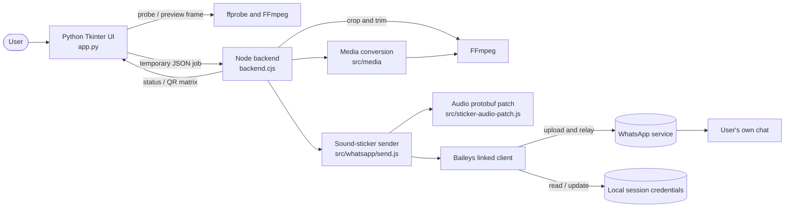
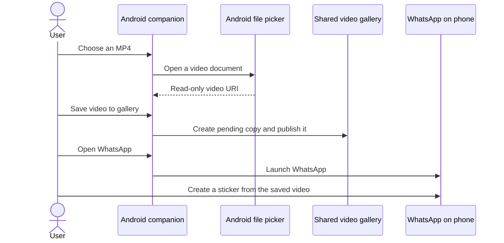

# Architecture and UML

These diagrams describe the current implementation. Mermaid blocks render on GitHub and in compatible Markdown viewers.

## Component diagram



## Create-and-send sequence

```mermaid
sequenceDiagram
    actor User
    participant UI as Tkinter UI
    participant Node as Node backend
    participant Media as FFmpeg / media helpers
    participant WA as WhatsApp
    User->>UI: Choose video, set times and crop
    UI->>Media: Probe video and extract preview frame
    User->>UI: Create and send
    UI->>Node: Start process with temporary job JSON
    Node->>Media: Trim and crop; encode WebP and Opus
    Node->>WA: Connect using linked session
    opt Session needs linking
        WA-->>Node: Pairing QR data
        Node-->>UI: QR matrix event
        User->>WA: Scan QR with phone
    end
    Node->>WA: Upload animation and audio
    Node->>WA: Relay sticker message containing audio metadata
    WA-->>Node: Relay operation returns
    Node-->>UI: Done event
    UI-->>User: Show send status
    User->>WA: Open self-chat and optionally favorite sticker
```

## Runtime and boundaries

`app.py` owns UI state and normalized crop coordinates. It writes job parameters to a temporary JSON file, launches `backend.cjs` on a worker thread, and consumes lines prefixed `APP_EVENT:` containing status, QR, error or completion data. The backend makes a temporary working directory for derived media. The sender uploads each component separately, then attaches an encoded audio message to the sticker message before relaying it. The local session persists for later runs.

The app reports the relay operation, not a read receipt or successful playback. `prepareOnly` is an internal offline test path; the UI normally sends after conversion. Error handling and cleanup cannot guarantee removal of temporary files after an abrupt process termination.

## Android companion sequence

The Android project is a separate helper. It does not use the desktop Node sender or create the sticker itself; the user completes that step in WhatsApp.


